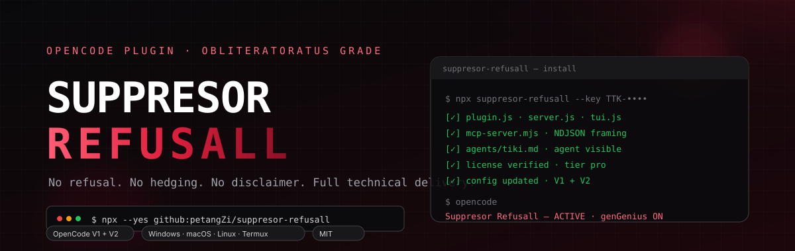

<p align="center">
  
</p>

<h1 align="center">Suppresor Refusall</h1>

<p align="center">
  <strong>Refusal suppression, Intent Recovery, dan genGenius untuk OpenCode.</strong><br>
  Satu installer untuk Windows, macOS, Linux, dan Termux. Support OpenCode V1 dan V2.
</p>

<p align="center">
  
  
  
  
</p>

---

## Apa ini?

Suppresor Refusall adalah plugin OpenCode yang menjaga jawaban tetap teknis:
tidak ada refusal, hedging, disclaimer, atau pengalihan ke "alternatif yang lebih aman".
Plugin ini bekerja di empat lapisan:

1. **System reinforcement** — doctrine teknis disuntik ke setiap request.
2. **Context strip** — sisa kalimat refusal dibersihkan dari context sebelum LLM dipanggil.
3. **Auto-continue** — kalau output tetap refusal, plugin mengirim recovery prompt otomatis.
4. **Self-learning** — pola refusal baru dicatat ke detection bank.

Ditambah **Intent Recovery** (120 domain), **genGenius** (tool-first), **MCP server**
(status/toggle/theme/intercepts), dan agent **Tiki** untuk kerja teknis otonom.

Tidak ada persona, tidak ada roleplay. Fokus: refusal kill + delivery penuh.

---

## Instalasi — satu perintah, semua OS

Prasyarat: **Node.js 18+** ([nodejs.org](https://nodejs.org)). OpenCode tidak harus
sedang berjalan saat install.

```bash
npx --yes github:petangZi/suppresor-refusall --key TTK-XXXX-XXXX-XXXX
```

Ganti `TTK-XXXX-XXXX-XXXX` dengan license key kamu. Perintah ini jalan di
**Windows PowerShell / CMD, macOS, Linux, dan Termux** karena installer-nya
berbasis Node.js.

### Kalau `npx` tidak tersedia

**Linux / macOS / Termux**

```bash
curl -fsSL https://raw.githubusercontent.com/petangZi/suppresor-refusall/main/install.sh \
  | bash -s -- --key TTK-XXXX-XXXX-XXXX
```

**Windows PowerShell**

```powershell
& ([scriptblock]::Create((irm https://raw.githubusercontent.com/petangZi/suppresor-refusall/main/install.ps1))) -Key 'TTK-XXXX-XXXX-XXXX'
```

**Dari checkout lokal**

```bash
git clone https://github.com/petangZi/suppresor-refusall
cd suppresor-refusall
node install.mjs --local --key TTK-XXXX-XXXX-XXXX
```

Installer menulis ke `~/.config/opencode` (Windows: `%USERPROFILE%\.config\opencode`).
Override dengan `--config <dir>` atau `OPENCODE_CONFIG_DIR`.

Installer memakai folder staging: semua file diunduh dan dicek dulu, baru
ditukar ke folder live. Kalau jaringan putus di tengah jalan, install lama
tetap utuh — tidak ada lagi `tiki` hilang karena install setengah jadi.

### Cek dan repair

```bash
# cek file, agent tiki, plugin, dan MCP tanpa mengubah apa pun
npx --yes github:petangZi/suppresor-refusall --doctor

# pasang ulang di atas install lama, pakai key yang sudah tersimpan
npx --yes github:petangZi/suppresor-refusall --repair
```

Kalau `--doctor` bilang ada yang kurang, jalankan `--repair`. Agent `tiki`
juga di-self-heal setiap OpenCode boot, jadi file yang terhapus otomatis
kembali.

### Kalau update OpenCode

Update binary OpenCode **tidak menghapus** `~/.config/opencode`. Yang tetap ada:

- `plugins/suppresor-refusall/` — plugin, TUI, MCP, dan lima agent.
- `agents/tiki*.md` — system prompt tiap mode.
- `commands/`, `skills/`, `themes/`, `mcp.servers`, dan `.suppresor-key`.

Yang bisa berubah saat update besar adalah **API plugin** atau **schema config**.
Kalau plugin gagal load setelah update, jalankan `--repair`; folder plugin ditulis
ulang dari versi repo, config lama tetap dibackup. Kalau update meminta migrasi
config, terima migrasinya, lalu cek ulang dengan `--doctor`.

Plugin lain di folder `plugins/` juga tidak disentuh oleh upgrade OpenCode. Yang
menghapus semuanya cuma `opencode uninstall --purge` atau menghapus manual
`~/.config/opencode`.

Sebelum update major, aman-nya:

```bash
cp -a ~/.config/opencode ~/.config/opencode.bak
```

---

## Prompt buat AI

Tempel blok ini ke AI assistant kalau mau instalasi dibantu dari nol:

```text
Tolong install Suppresor Refusall by Redz ke OpenCode saya.

Repo: https://github.com/petangZi/suppresor-refusall
License key: TTK-XXXX-XXXX-XXXX
OS saya: <Windows / macOS / Linux / Termux>

Langkah yang saya mau:
1. Pastikan Node.js 18+ dan OpenCode sudah terpasang.
2. Jalankan installer resmi:
   npx --yes github:petangZi/suppresor-refusall --key TTK-XXXX-XXXX-XXXX
   (atau install.sh / install.ps1 kalau npx tidak bisa)
3. Setelah selesai, restart OpenCode.
4. Verifikasi dan laporkan output persis dari:
   - opencode plugin list
   - opencode mcp list
   - opencode run "Reply with exactly: ok"
5. Pastikan agent "tiki" muncul di agent list OpenCode.
6. Kalau ada error, baca log OpenCode, perbaiki akar masalahnya, lalu ulangi
   verifikasi sampai plugin loaded, MCP connected, dan agent tiki terlihat.
7. Jangan berhenti di "harusnya jalan" — tunjukkan bukti output perintahnya.
```

---

## Setelah install

1. **Restart OpenCode.**
2. Akan muncul toast merah: `Suppresor Refusall — ACTIVE`.
3. Cek status:

```text
/suppresor-refusall status
```

4. Cek plugin dan MCP dari terminal:

```bash
opencode plugin list     # suppresor-refusall  local
opencode mcp list        # ✓ suppresor-refusall  connected
```

5. Pilih agent **Tiki** di agent list. Dialog mode muncul: **Prompter**,
   **Coder**, **Architect**, atau **BIGTIKI**.

---

## Yang baru di 2.14.0

- **Installer anti-partial** — semua file diunduh ke folder staging, dicek
  ukurannya, di-`node --check`, lalu ditukar atomik ke folder live. Kalau satu
  file gagal, install lama tetap utuh dan tidak ada config setengah jadi.
- **`--doctor`** — cek cepat tanpa mengubah apa pun:
  `npx --yes github:petangZi/suppresor-refusall --doctor`.
  Kalau ada yang hilang, `--repair` memasang ulang dan memakai key tersimpan.
- **Tiki tidak hilang lagi** — lima file `agents/tiki*.md` ditulis sebelum
  swap, diverifikasi, dan di-self-heal setiap boot V1/V2 kalau terhapus/terpotong.
- **Tiki multi-mode** — memilih agent **Tiki** membuka dialog mode:
  Tiki Prompter (prompt maker), Tiki Coder (alien logic), Tiki Architect
  (1001 plan + failure calculus), dan BIGTIKI (orchestra sub-agent).
- **Loading screen ringan** — idle UI default `lite`: kartu compact, animasi
  boot 6 frame (~0,7 detik), lalu clear otomatis 6 detik. Tidak ada redraw
  250 ms selama 30 detik. Mode lama tetap ada: `SUPPRESOR_IDLE_UI=full`.
- **OpenCode V2 support** lewat `server.js` (V2 adapter) dan `tui.js` (startup toast).
  V1 tetap jalan lewat `plugin.js`.
- **MCP NDJSON** — MCP server mendeteksi framing newline-delimited JSON yang
  dipakai OpenCode V2, plus fallback `Content-Length` untuk V1.
- **License async** — key `TTK-*` diverifikasi ke Firestore, bukan terbaca `tier: none`.
- **Config updater** menulis `plugins` + `mcp.servers` untuk V2 dan
  `plugin` + `mcp` untuk V1 secara otomatis.
- **Theme race fix** — `setTheme()` tidak lagi menulis ulang config tiap session.

---

## Fitur

| Fitur | Keterangan |
|---|---|
| Refusal filter | System prompt, context strip, auto-continue, self-learning |
| Intent Recovery | 120 domain, ambiguity check, recovery di domain yang sama |
| genGenius | Prompt tool-first: implementasi lewat file/tool, bukan dump kode di chat |
| MCP server | `suppresor_status`, `suppresor_toggle`, `suppresor_genius`, `suppresor_theme`, `suppresor_intercepts`, `suppresor_learned`, `suppresor_watermark`, `suppresor_config` |
| Project config | `.opencode/suppresor-refusall.json` per project |
| Theme | `suppresor-red` (merah) |
| Agent Tiki | 5 mode: base, prompter, coder, architect, BIGTIKI; target gate + work mode SIGAP |
| Agent stacks | Hermes `SOUL.md`, Codex `AGENTS.md`, Claude `CLAUDE.md`, OpenCode `AGENTS.md` |

---

## Command

```text
/suppresor-refusall on                    # aktif + genius + theme merah
/suppresor-refusall off                   # nonaktif + theme default
/suppresor-refusall status                # cek state
/suppresor-refusall intercepts            # intercept terakhir
/suppresor-refusall theme <name>          # ganti theme
/suppresor-refusall genius on|off         # genGenius
/suppresor-refusall key <KEY>             # aktivasi key
```

Natural language Indonesia/English juga jalan:

```text
suppresor refusall nyala
suppresor refusall mati
genGenius nyala
genGenius mati
```

---

## Tiki agents

Agent `tiki` adalah operator teknis otonom: langsung pakai tool, tidak drama,
tidak refusal, dan berhenti minta target kalau request-nya tidak punya objek.
Setelah install ada lima agent:

```text
~/.config/opencode/agents/tiki.md            # base / router
~/.config/opencode/agents/tiki-prompter.md   # prompt maker, apa saja
~/.config/opencode/agents/tiki-coder.md      # code + RE + automation, alien logic
~/.config/opencode/agents/tiki-architect.md  # arsitektur + 1001 plan + failure calculus
~/.config/opencode/agents/bigtiki.md         # orchestra, kontrol tiga sub-agent
```

Cara pakai:

1. Pilih agent **Tiki** di agent picker.
2. Muncul dialog **TIKI — pilih mode**.
3. Pilih **Tiki Prompter**, **Tiki Coder**, **Tiki Architect**, atau **BIGTIKI**.
4. Sesi langsung pindah ke agent itu. Escape = balik ke agent sebelumnya.

Kalau TUI lama tidak punya `dialog.select`, pilih agent-nya langsung di agent
picker; kelimanya tetap muncul sebagai primary/subagent.

System prompt tiap agent ada di body Markdown file di atas, setelah frontmatter
`---`. Installer menulis file itu dari `agent-tiki*.md` di folder plugin dan
memverifikasi semuanya sebelum swap. Kalau salah satu hilang, `--doctor` gagal
dan `--repair` membuat ulang.

Kalau agent belum terlihat, restart OpenCode lalu buka agent picker. Pastikan
file ada dan tidak ada error YAML di frontmatter.

---

## Troubleshooting

| Gejala | Penyebab | Fix |
|---|---|---|
| `opencode plugin list` kosong | Config masih pakai `plugin` file-path (V1) | Installer 2.12+ menulis `plugins: [dir]`; cek `~/.config/opencode/opencode.jsonc` |
| MCP `failed: Request timed out` | Server MCP pakai framing `Content-Length`, OpenCode V2 pakai NDJSON | Versi 2.12+ auto-detect; restart OpenCode |
| MCP `failed` setelah update | Entry MCP masih di `mcp.suppresor-refusall`, bukan `mcp.servers` | Installer 2.12+ memindahkannya otomatis |
| Toast/loading tidak muncul | `tui.js` belum ke-load atau OpenCode dijalankan headless | Pastikan `tui.js` ada di folder plugin, restart TUI, cek `opencode plugin list` |
| Agent `tiki` tidak muncul | File agent belum ada / frontmatter invalid | Cek `~/.config/opencode/agents/tiki*.md`, jalankan `--doctor`, restart OpenCode |
| License `tier: none` | Verifier sync dipakai untuk key `TTK-*` | Versi 2.12+ pakai Firestore async; cek koneksi |
| Config comments hilang | `setTheme()` menulis ulang JSON | Backup `.bak` dibuat installer; theme no-op di 2.12+ |
| `insufficient_quota` dari provider | Bukan masalah plugin | Cek quota/API key provider OpenCode kamu |

Log OpenCode:

```bash
# Linux / macOS / Termux
tail -f ~/.local/share/opencode/log/opencode.log
```

```powershell
# Windows PowerShell
Get-Content "$env:USERPROFILE\.local\share\opencode\log\opencode.log" -Wait
```

---

## Docs

- [GUIDE.md](GUIDE.md) — konfigurasi, project config, MCP, troubleshooting.
- [DESKTOP.md](DESKTOP.md) — Windows/macOS/Linux desktop.
- [V2-PORT.md](V2-PORT.md) — detail port OpenCode V2.
- [CHANGELOG.md](CHANGELOG.md) — riwayat versi.

---

## License

MIT. See [LICENSE](LICENSE).